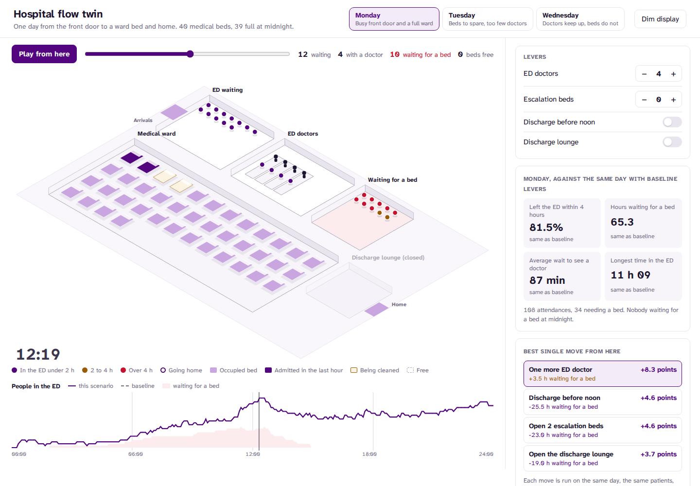
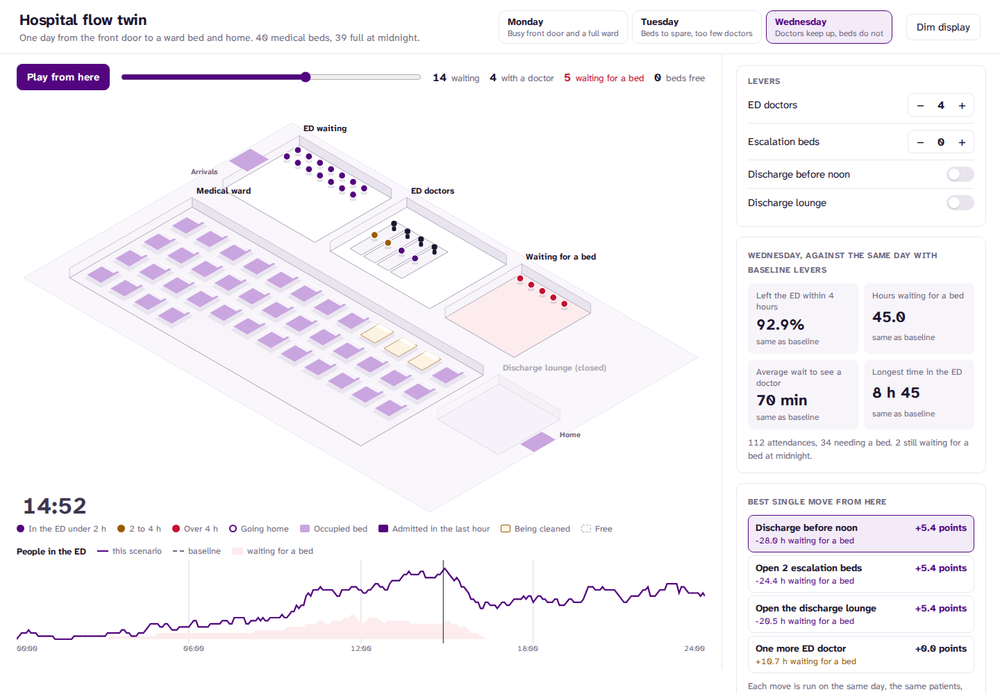
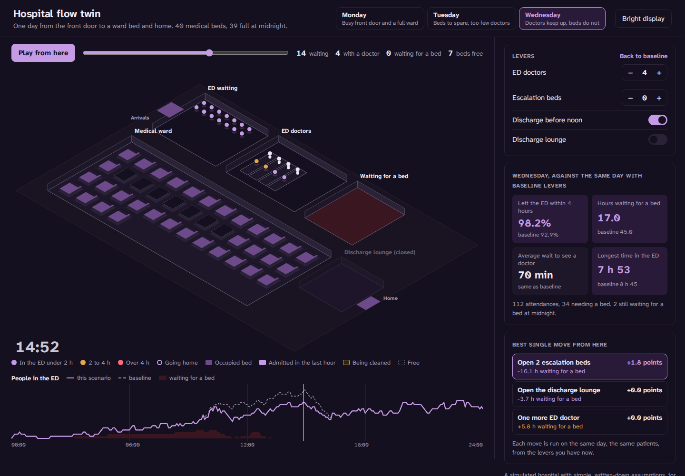

# Hospital flow twin

Live: https://flow-twin.vercel.app

An isometric digital twin of a small hospital's flow. A simulated day runs from the front door,
through the emergency department (ED), to a ward bed and home. Levers ask what would happen with
more ED doctors, escalation beds, earlier discharges or a discharge lounge. Every scenario runs
against the same baseline day, so any difference comes from the lever and not from luck.



When an ED is overwhelmed, the instinct is to add ED staff. Often the real constraint is
upstairs: no ward bed is free because most discharges happen late in the afternoon. This twin
makes the constraint visible and shows that it moves from day to day.

- **One day, seen as it happens.** Patients arrive, wait, see a doctor in a cubicle, then go
  home or wait in the corridor for a bed. Ward beds show as occupied, newly admitted, being
  cleaned or free. Patients are coloured by how long they have been in the ED: purple under
  2 hours, amber 2 to 4, red over 4. Play the day in a minute, or scrub to any minute. Each day
  opens at its busiest minute.
- **Levers with fair comparisons.** The simulation is seeded, so a scenario sees exactly the
  same patients as the baseline: the same arrival times, assessment times and admission
  decisions, and the same readiness for discharge. The four headline measures show the
  scenario against the baseline for that day.
- **The best single move.** For the levers you have now, the twin runs each possible next move
  on the same day and ranks them by the share of patients leaving the ED within 4 hours, then
  by hours spent waiting for a bed. Click one to apply it.



## What the three days show

| Day | Within 4 hours | Hours waiting for a bed | Best move | One more ED doctor |
|---|---|---|---|---|
| Monday | 81.5% | 65.3 | One more ED doctor, +8.3 points | +8.3 points, but +3.5 h waiting for a bed |
| Tuesday | 73.5% | 5.5 | One more ED doctor, +26.5 points | Beds were never the problem |
| Wednesday | 92.9% | 45.0 | Discharge before noon, +5.4 points and 28 fewer hours waiting for a bed | **+0.0 points and 10.7 more hours waiting for a bed** |

Wednesday is the lesson. With the ward full, an extra doctor sees patients faster, so they
reach the bed queue sooner and wait there longer. Not one more patient leaves the ED within
4 hours. Moving a third of discharges before noon, opening two escalation beds or opening a
discharge lounge each recover the same 5.4 points. On Tuesday the reverse is true: beds are
free and the doctors are the constraint. The twin does not have a favourite lever. It reports
whichever one the day needs.

## The model

Simple, and written down so every assumption can be argued with:

- **Arrivals.** About 110 patients a day, drawn minute by minute from an hourly weekday
  profile.
- **Assessment.** Times are lognormal around 45 minutes, kept between 15 and 240.
- **Admission.** About 30% of patients need a ward bed.
- **ED doctors.** Patients are seen first come, first served.
- **The ward.** 40 medical beds, 39 full at midnight. 32 patients are ready for discharge
  during the day, timed by an hourly profile that peaks in the late afternoon. Each bed takes
  30 minutes to clean.
- **Discharge before noon.** The same discharges, through a profile with a third before 12:00.
- **Discharge lounge.** For discharges after 10:00, the bed is freed 90 minutes earlier while
  the patient waits in the lounge for transport.
- **Breaches.** Anyone still in the ED at midnight counts as a breach if they have been there
  over 4 hours.

The randomness is seeded (Mulberry32). Each lever changes only what it says it changes, so a
comparison is between two runs of the same day.

## Tested

17 tests:

- **The random day:** it reproduces from its seed, has typical volumes, and the noon profile
  moves a third of discharges.
- **Accounting:** every patient is waiting, with a doctor, waiting for a bed, or gone, and the
  minute-by-minute census agrees.
- **Event order and fairness:** events happen in order for each patient, and patients are seen
  first come, first served.
- **Beds:** no bed holds two patients, and a bed is cleaned before reuse.
- **Capacity:** never more doctors busy than on duty.
- **The 4-hour measure.**
- **Levers:**
  - more doctors always shorten the wait to be seen
  - more doctors save no breaches on Wednesday
  - earlier discharges cut boarding when the ward is the constraint
  - escalation beds never make boarding worse
  - a lounge only ever frees beds earlier
- **Best moves:** they choose a doctor on Tuesday and a ward change on Wednesday, and never
  offer a move already made.
- **Opening view:** each day opens at its busiest minute.

## Design

Same design system as the clinical projects: white, one purple for interaction, Atkinson
Hyperlegible Next bundled with the app. Amber and red mean only time in the ED. The isometric
plan is drawn in SVG with no 3D library. People move between places with a short eased
transition, which reduced-motion settings turn off. Dim display follows the system or the button.



## Run it

```bash
npm install
npm run dev
npm test && npm run lint && npm run typecheck
npm run build          # static site in dist/
npm run build:single   # one self-contained HTML file in dist-single/
```

## Not a planning tool

A simulated hospital with simple assumptions, for demonstrating interface design and flow logic.
The numbers describe this model, not any real hospital.

## Author

Samuel Henry Mba
